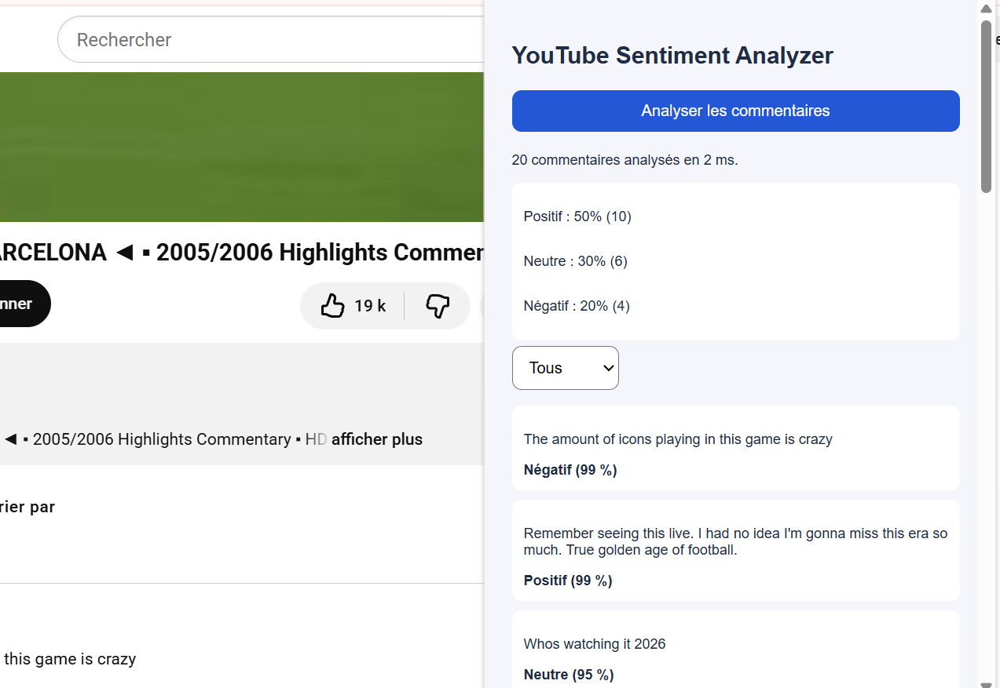
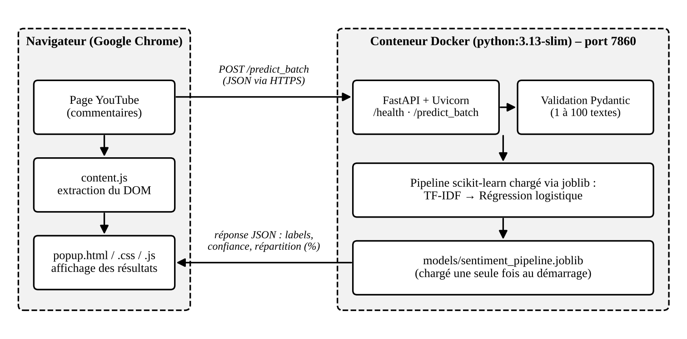
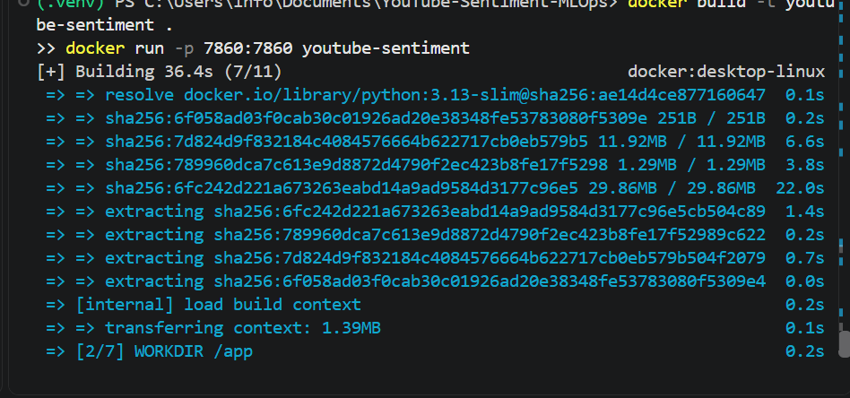
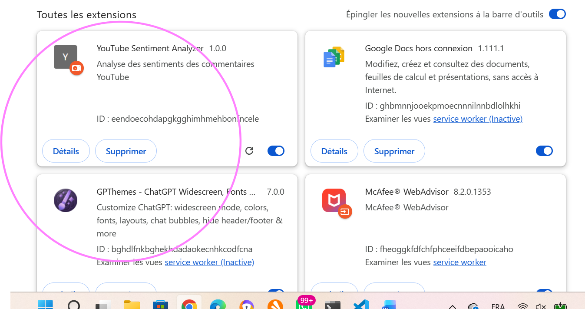
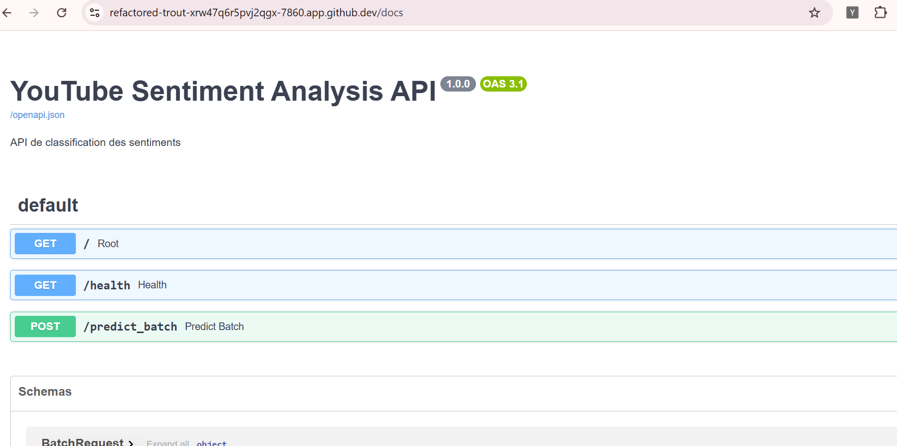
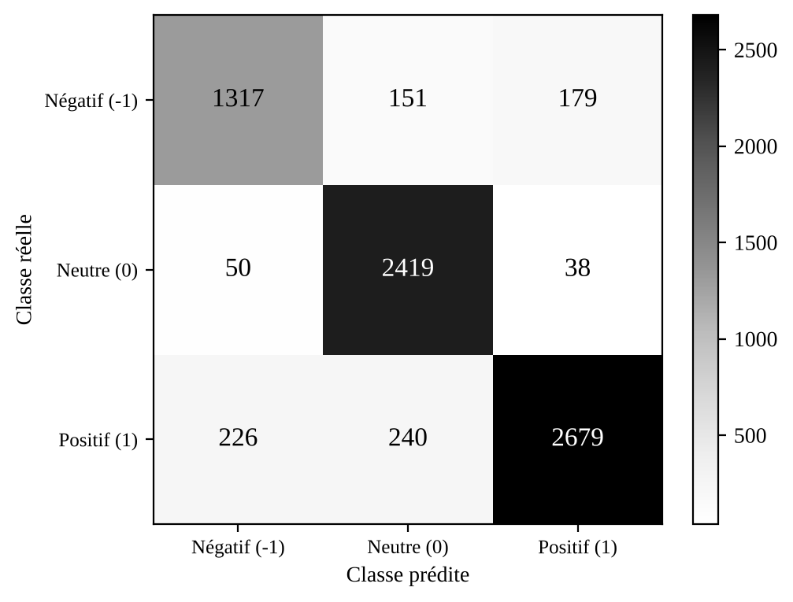
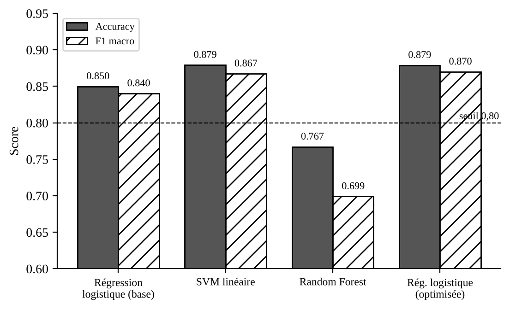

# YouTube Sentiment MLOps

Analyse automatique du sentiment (négatif / neutre / positif) des commentaires YouTube, de la donnée brute jusqu'à une extension Chrome.
Projet **TP3 – Cloud Computing** (ENSAM Rabat, filière INDIA, 2026/27) – Prof. Maria Zemzami – réalisé par **RAJI Amina**.



## Description

Le système analyse en quelques millisecondes les commentaires d'une vidéo YouTube :

- **Modèle** : TF-IDF + régression logistique (scikit-learn), optimisé par GridSearchCV
- **API** : FastAPI (`/health`, `/predict_batch`), conteneurisée avec Docker
- **Frontend** : extension Chrome (statistiques, liste des commentaires, filtre, confiance)
- **Tests** : 34 tests pytest (12 modèle, 22 API)

| Métrique | Exigé | Obtenu |
|---|---|---|
| Accuracy | ≥ 80 % | **87,89 %** |
| F1 par classe | > 0,75 | **0,813 / 0,910 / 0,887** |
| Inférence (50 commentaires) | < 100 ms | **≈ 1,5 ms** |

## Architecture



1. L'utilisateur ouvre une vidéo YouTube.
2. L'extension extrait les commentaires affichés.
3. Elle les envoie en un lot à l'API (`POST /predict_batch`).
4. L'API valide (Pydantic) et applique le pipeline scikit-learn.
5. Les prédictions (label, confiance, répartition) sont renvoyées.
6. L'extension affiche les résultats.

## Structure du dépôt

```
data/            raw/ (données originales) et processed/ (nettoyées, train/test)
models/          pipeline .joblib, métriques, script d'entraînement
src/             data/, models/, api/
chrome-extension/  manifest.json, content.js, popup.html/css/js
tests/           tests du modèle et de l'API (pytest)
reports/         sorties d'exécution des tests
Dockerfile, requirements.txt, requirements-prod.txt, app_api.py
```

## Installation et utilisation

### 1. Environnement

```bash
python -m venv .venv
source .venv/bin/activate        # Windows : .venv\Scripts\Activate.ps1
pip install -r requirements.txt
```

### 2. Données et modèle (optionnel : le modèle est déjà fourni)

```bash
python src/data/prepare_data.py
python models/train_model.py
python src/models/compare_models.py
```

### 3. Lancer l'API

```bash
uvicorn src.api.main:app --host 0.0.0.0 --port 7860
# documentation interactive : http://localhost:7860/docs
```

### 4. Avec Docker

```bash
docker build -t youtube-sentiment .
docker run -d --restart unless-stopped --name sentiment-api -p 7860:7860 youtube-sentiment
curl http://localhost:7860/health
```



### 5. Extension Chrome

1. Ouvrir `chrome://extensions` et activer le **mode développeur**.
2. **Charger l'extension non empaquetée** → dossier `chrome-extension/`.
3. Dans `chrome-extension/popup.js`, régler `API_URL` (par défaut l'URL de l'API déployée, ou `http://localhost:7860`).
4. Ouvrir une vidéo YouTube, faire défiler jusqu'aux commentaires, cliquer sur l'icône puis **Analyser les commentaires**.



## Documentation de l'API

| Endpoint | Méthode | Description |
|---|---|---|
| `/health` | GET | État de l'API et du modèle |
| `/predict_batch` | POST | Analyse 1 à 100 commentaires |

```bash
curl -X POST http://localhost:7860/predict_batch \
  -H "Content-Type: application/json" \
  -d '{"comments": ["I love this video", "This is terrible"]}'
```

Réponse :

```json
{
  "total_comments": 2,
  "results": [
    {"comment": "I love this video", "label": 1, "sentiment": "Positif", "confidence": 0.95},
    {"comment": "This is terrible", "label": -1, "sentiment": "Négatif", "confidence": 0.93}
  ],
  "distribution": {"negative": 1, "neutral": 0, "positive": 1},
  "percentages": {"negative": 50.0, "neutral": 0.0, "positive": 50.0},
  "processing_time_ms": 2.1
}
```

(Valeurs de confiance données à titre d'illustration.) Codes d'erreur : `400` commentaire vide, `422` données invalides ou lot hors limites (1–100), `503` modèle non chargé.



## Résultats du modèle




| Modèle | Accuracy | F1 macro |
|---|---|---|
| Régression logistique (référence) | 0,8498 | 0,8402 |
| SVM linéaire | 0,8792 | 0,8673 |
| Random Forest | 0,7672 | 0,6991 |
| **Régression logistique optimisée** (C = 2,0 ; unigrammes) | **0,8789** | **0,8699** |

## Tests

```bash
pytest tests/test_model.py tests/test_model_extra.py -v -s     # modèle
pytest tests/test_api.py tests/test_api_extra.py -v -s         # API (doit tourner)
API_URL=https://<url-publique> pytest tests/test_api.py tests/test_api_extra.py -v -s
```

Les rapports d'exécution sont dans `reports/`.

## Déploiement

L'API est déployée dans un conteneur Docker (port 7860) exposé en HTTPS. Le Dockerfile est compatible **Hugging Face Spaces** (SDK Docker) : créer un Space *Docker*, puis placer en tête du `README.md` du Space :

```yaml
---
title: YouTube Sentiment API
sdk: docker
app_port: 7860
---
```

## Limites connues

- Modèle entraîné sur des commentaires Reddit en anglais : les textes en arabe, en émojis seuls ou en français sont souvent classés « Neutre ».
- La confiance affichée n'est pas calibrée.
- Seuls les commentaires affichés dans la page sont analysés.

## Documents

Rapport technique complet : `Rapport_TP3_YouTube_Sentiment_MLOps.pdf`.
